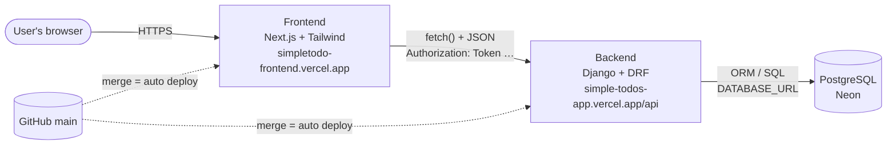
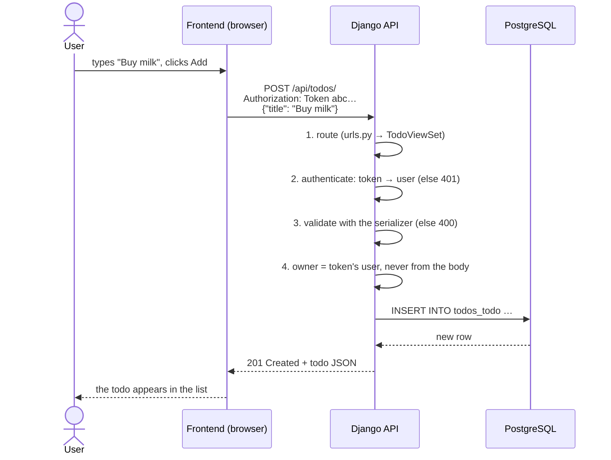
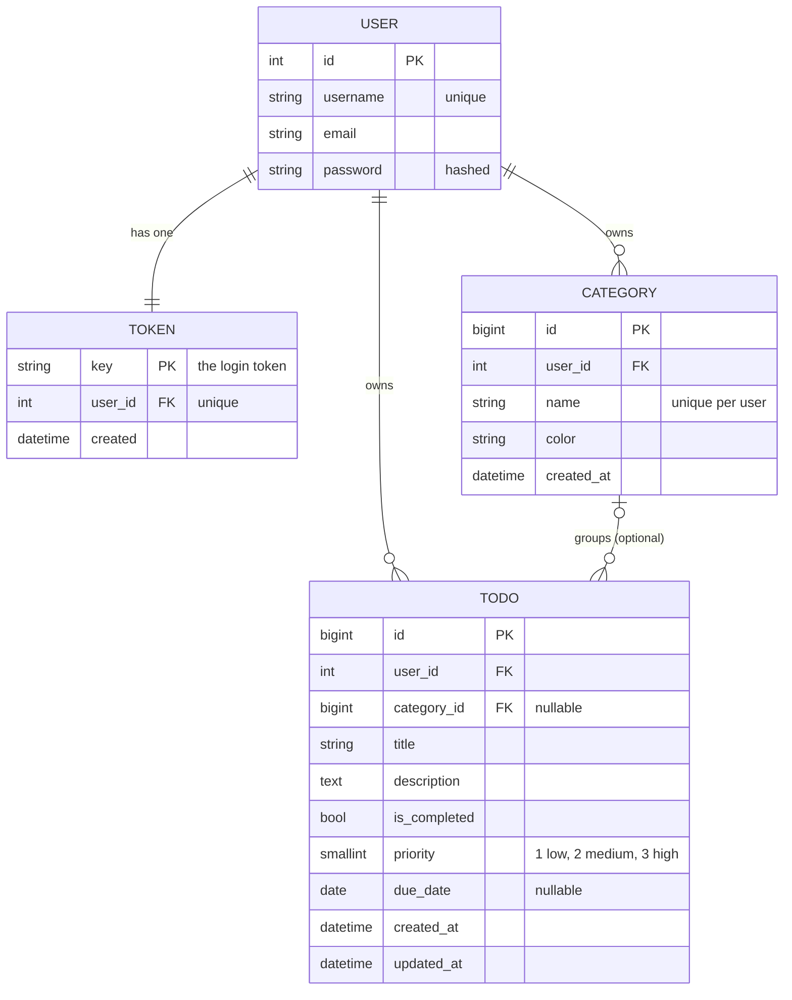

# Simple Todo List App

A full-stack, multi-user todo app. Each person signs up, logs in, and manages their own todos, with categories, priorities and due dates. Nobody can see anyone else's data.

**Live app:** https://simpletodo-frontend.vercel.app
**API:** https://simple-todos-app.vercel.app/api/health/

| Layer    | Tech | Hosting |
|----------|------|---------|
| Frontend | Next.js 16 (App Router, TypeScript), React 19, Tailwind CSS 4 | Vercel |
| Backend  | Python 3.12, Django 6, Django REST Framework (token auth) | Vercel (serverless function, Singapore) |
| Database | SQLite (local) / PostgreSQL on Neon (production) | Neon (Singapore) |

## Architecture



- **Frontend**: shows the screens and talks to the API. Its checks are only for convenience.
- **Backend**: the only door to the database. It authenticates every request (token), validates input, and scopes every query to the logged-in user.
- **Database**: stores users, tokens, categories and todos.
- **Configuration** comes from environment variables, so the same code runs locally and in production. The backend only accepts browser requests from the frontend's origin (CORS).

## How a request flows: creating a todo



## Database design (ERD)



| Rule | Why |
|---|---|
| **User** and **Token** are built in (Django auth, DRF authtoken) | safe password hashing and token handling, already tested |
| Category and Todo have a `user_id` foreign key | every query is filtered by it, so users only ever see their own data |
| Deleting a user **CASCADE**s to their token, categories and todos | they have no meaning without their owner |
| Deleting a category **SET_NULL**s its todos' `category_id` | a todo is still valid without a label |
| `UNIQUE(user_id, name)` on Category | two users may both have "Work"; one user can't have it twice |
| Priority stored as 1/2/3 | sorts by importance; text would sort alphabetically |
| Default order: unfinished first, then due date (no date last), priority, newest | what a user wants at the top |

## API

| Method | Endpoint | Auth | Purpose |
|---|---|---|---|
| POST | `/api/auth/register/` | – | create an account, returns a token |
| POST | `/api/auth/login/` | – | returns the user's token |
| POST | `/api/auth/logout/` | token | deletes the token |
| GET | `/api/auth/me/` | token | the current user |
| GET, POST | `/api/todos/` | token | list (`?completed=`, `?category=`) / create |
| GET, PATCH, DELETE | `/api/todos/<id>/` | token | one todo (another user's id → 404) |
| GET, POST | `/api/categories/` | token | list / create |
| PATCH, DELETE | `/api/categories/<id>/` | token | one category |

## Repository layout

```
frontend/   Next.js app (pages in src/app/, components in src/components/, API client in src/lib/)
backend/    Django project (config/) and the todos app (models, serializers, views, tests)
```

## Run locally

Backend:
```bash
cd backend
python3.12 -m venv .venv
.venv/bin/pip install -r requirements.txt
cp .env.example .env            # then set DJANGO_SECRET_KEY
.venv/bin/python manage.py migrate
.venv/bin/python manage.py test # 12 tests
.venv/bin/python manage.py runserver
```

Frontend (in a second terminal):
```bash
cd frontend
cp .env.example .env.local      # NEXT_PUBLIC_API_URL=http://127.0.0.1:8000/api
npm install
npm run dev                     # http://localhost:3000
```

## Deployment

Two Vercel projects deploy from `main` automatically: root directory `backend` and root directory `frontend`.

| Project | Environment variables |
|---|---|
| Backend | `DJANGO_SECRET_KEY`, `DJANGO_DEBUG=False`, `DJANGO_ALLOWED_HOSTS=.vercel.app`, `CORS_ALLOWED_ORIGINS=<frontend URL>`, `DATABASE_URL` (Neon) |
| Frontend | `NEXT_PUBLIC_API_URL=<backend URL>/api` |
